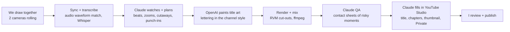

# AI video editing pipeline: from two raw camera files to a finished YouTube episode

My boys asked if we could start a YouTube channel together, so we did: **Super Art Bros**, a how-to-draw series. We set up two cameras and filmed a bunch of episodes. I used to be a video editor, and I did the first edit myself... it took forever. Editing was the bottleneck, the project stalled, and we stopped drawing together the way we had been.

So I built this. The creative part I want to keep is the drawing, and the time with my sons. The edit is the part I handed off.

**Raw footage in:** an iPad on our faces and an iPhone overhead on the paper, about 27 minutes per session.
**Finished episode out:** an edited 10–15 minute episode with titles, zooms, cutaways, a coloring montage, an outro made from the kids' real drawings, a thumbnail, and upload metadata.

> Demo reel: _(link to the promo video)_

## How it works



| Step | Who | What happens |
|---|---|---|
| 1. Capture | me + the boys | iPad front camera, iPhone overhead camera, same session |
| 2. Prep | `pipeline/sab_prep.py` | Finds the offset between the two angles by cross-correlating the audio, pulls 1 fps keyframes, detects both sheets of paper every second, measures pen activity |
| 3. Transcribe | Whisper (`faster-whisper`, local) | Dialogue from the overhead mic |
| 4. Plan | Claude | Reads the transcript and contact sheets, writes `episode.json`: beats, skips, detail-zoom windows, cutaway candidates (verified against frames), title timing, punch-ins, face centers |
| 5. Edit list | `pipeline/sab_edl.py` | Turns the plan into an EDL and enforces the editing rules |
| 6. Artwork | OpenAI image edits + `tools/` | Subject lettering matched to the channel's hand-lettered style, aligned to the header's slant; the kids' drawings extracted from late frames for the outro and thumbnail |
| 7. Render | `pipeline/sab_render.py`, `sab_intro.py`, `sab_iris.py` + ffmpeg | Virtual camera (auto-framing, detail zooms that glide from my paper to my kid's), title behind the people via an RVM matte, 10x coloring montage, review layout, iris into the outro, one sample-accurate audio mix at -14 LUFS |
| 8. QA | Claude | Contact sheets of the title, zooms, cutaways, review card, iris, outro |
| 9. Upload | Claude in the browser | YouTube Studio: title, description with chapters, thumbnail, made for kids, **Private**. I review and publish. |

## Design decisions

- **The kids' faces are never generated.** Thumbnails and the outro use their real drawings, composited onto a reusable AI-painted plate. Image models subtly change real faces, and with my kids that matters.
- **Upload through YouTube Studio, not the API.** Uploads from unaudited API projects are locked to private. Studio also keeps a human in the loop for the publish click.
- **Signals are hints; frames are the judge.** Pen activity flags candidate cutaways, but hands gesturing over the paper look the same as drawing. Every cutaway candidate is checked against overhead frames before it's kept.
- **Editing rules live in code.** Cutaways only land on reactions (praise or questions, never instructions), are 6 s or shorter, and are at least 35 s apart. The EDL step enforces this so the plan can't drift.
- **One continuous audio mix.** Segments are rendered video-only and the dialogue is mixed once, sample-accurate, so there are no clicks or drift at the cuts.
- **Resumable everything.** Each step skips work that already exists, so long 4K renders survive interruptions.

## Repo layout

```
pipeline/   prep → edl → render (segments, intro, iris, assemble, finalize)
tools/      OpenAI lettering + plates, title alignment, drawing extraction, outro, thumbnails
promo/      the promo-reel builder (16:9 and 4:5) used for the demo video
examples/   a sample episode.json (synthetic; names and transcript lines removed)
```

## Running it

Requirements: Python 3.10+, ffmpeg, the packages in `requirements.txt`, and an OpenAI API key for the lettering step (`cp .env.example secrets.env`, or export `OPENAI_API_KEY`).

```bash
export SAB_SSD=~/sab-data          # holds SAB-production/ and Projects/ (raw footage)
python3 pipeline/sab_prep.py ep01 IMG_front.mov IMG_top.mov --flip-front
# transcribe, then write episodes/ep01/episode.json (see examples/sample_episode)
python3 pipeline/sab_edl.py ep01
python3 pipeline/sab_render.py ep01 segments
python3 pipeline/sab_intro.py ep01
python3 pipeline/sab_render.py ep01 assemble
python3 pipeline/sab_render.py ep01 finalize
```

Brand assets (the channel's lettering, wordmark, and outro plate) aren't included, so you'd swap in your own.

## Built with

Claude (planning, editing decisions, QA, orchestration), the OpenAI image API (title lettering), Whisper, Robust Video Matting, OpenCV, and ffmpeg. Most of this was built pair-programming with Claude.

This repo is a sanitized mirror of my private production repo, regenerated on every change.
