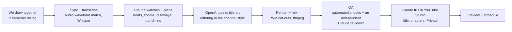

# AI video editing pipeline: from two raw camera files to a finished YouTube episode

My boys asked if we could start a YouTube channel together, so we did: **Super Art Bros**, a how-to-draw series. We set up two cameras and filmed a bunch of episodes. I used to be a video editor, and I did the first edit myself... it took forever. Editing was the bottleneck, the project stalled, and we stopped drawing together the way we had been.

So I built this. The creative part I want to keep is the drawing, and the time with my sons. The edit is the part I handed off.

**Raw footage in:** an iPad on our faces and an iPhone overhead on the paper, about 27 minutes per session.
**Finished episode out:** an edited 8–11 minute 4K episode with titles, zooms, cutaways, a coloring montage, an outro made from the kids' real drawings, a thumbnail, and upload metadata.

## How it works



| Step | Who | What happens |
|---|---|---|
| 1. Capture | me + the boys | iPad front camera, iPhone overhead camera, same session |
| 2. Prep | `pipeline/sab_prep.py` | Finds the offset between the two angles by cross-correlating the audio, pulls 1 fps keyframes, detects both sheets of paper every second, measures pen activity |
| 3. Transcribe | Whisper (`faster-whisper`) | Dialogue from the overhead mic, with word timestamps where a cut must be exact |
| 4. Plan | Claude + `tools/head_boxes.py` | Reads the transcript and contact sheets, writes `episode.json`: beats (with ranges that cut out fumbles and retakes), skips, detail-zoom windows, cutaway candidates (verified against frames), title timing, punch-ins, and each person's head box over the intro |
| 5. Whose paper | `pipeline/sab_sides.py` | Measures, second by second, how much of each sheet is covered by a hand, so the detail zoom follows whoever is drawing |
| 6. Edit list | `pipeline/sab_edl.py`, `sab_talk.py` | Turns the plan into an EDL and enforces the editing rules; `sab_talk.py` flags lines aimed at the editor or camera ("cue the music") and retakes that slipped into the cut |
| 7. Artwork | OpenAI image edits + `tools/` | Subject lettering matched to the channel's hand-lettered style, aligned to the header's slant; the kids' drawings extracted from late frames for the outro and thumbnail |
| 8. Render | `pipeline/sab_render.py`, `sab_intro.py`, `sab_wipe.py`, `sab_iris.py` + ffmpeg | 4K virtual camera (auto-framing, detail zooms that follow the drawing hand), a title placed behind or below the people so it never covers a face (RVM matte), face-safe punch-ins, 10x coloring montage, review layout with a face card, iris into the outro, one sample-accurate audio mix (two-pass loudnorm to -14 LUFS) |
| 9. QA | `pipeline/sab_qa.py`, `sab_qa_check.py` + a fresh Claude reviewer | Measures length, loudness, silences, black or frozen picture and every cut, runs automated checks, then a separate Claude agent that never saw the edit reviews the pack (`pipeline/reviewer_brief.md`) and lists blockers. Blockers get fixed before upload |
| 10. Upload | Claude in the browser + `pipeline/sab_youtube.py` | YouTube Studio: title, description with chapters, made for kids, **Private**. The Data API then sets the thumbnail and schedules the release. I review and launch. |

## Design decisions

- **The kids' faces are never generated.** Thumbnails and the outro use their real drawings, composited onto a reusable AI-painted plate. Image models subtly change real faces, and with my kids that matters.
- **Upload through YouTube Studio, not the API.** Uploads from unaudited API projects are locked to private. Studio also keeps a human in the loop for the publish click.
- **Never slice a head.** Punch-ins keep every head fully in or fully out of frame, and the title only goes where the person matte says it won't cover anyone.
- **A second pair of eyes.** QA ends with an independent Claude reviewer that only sees the measurements and contact sheets, so the edit isn't grading itself.
- **Fix, don't re-render.** `sab_patch`, `sab_regroup` and `sab_cutout` change part of a delivered 4K episode and copy the rest frame-exactly.
- **Signals are hints; frames are the judge.** Pen activity flags candidate cutaways, but hands gesturing over the paper look the same as drawing. Every cutaway candidate is checked against overhead frames before it's kept.
- **Editing rules live in code.** Cutaways only land on reactions (praise or questions, never instructions), are 6 s or shorter, and are at least 35 s apart. The EDL step enforces this so the plan can't drift.
- **One continuous audio mix.** Segments are rendered video-only and the dialogue is mixed once, sample-accurate, so there are no clicks or drift at the cuts.
- **Resumable everything.** Each step skips work that already exists, so long 4K renders survive interruptions.

## Repo layout

```
pipeline/   prep → edl → render (segments, intro, iris, assemble, finalize)
tools/      OpenAI lettering + plates, title alignment, drawing extraction, outro, thumbnails
promo/      the promo-reel builder (16:9 and 4:5) used for the demo video
examples/   a sample episode.json (synthetic; names and transcript lines removed)
```

## Running it

Requirements: Python 3.10+, ffmpeg, the packages in `requirements.txt`, and an OpenAI API key for the lettering step (`cp .env.example secrets.env`, or export `OPENAI_API_KEY`).

```bash
export SAB_SSD=~/sab-data          # holds SAB-production/ and Projects/ (raw footage)
python3 pipeline/sab_prep.py ep01 IMG_front.mov IMG_top.mov --flip-front
# transcribe, then write episodes/ep01/episode.json (see examples/sample_episode)
python3 pipeline/sab_edl.py ep01
python3 pipeline/sab_render.py ep01 segments
python3 pipeline/sab_intro.py ep01
python3 pipeline/sab_render.py ep01 assemble
python3 pipeline/sab_render.py ep01 finalize
```

Brand assets (the channel's lettering, wordmark, and outro plate) aren't included, so you'd swap in your own.

## Built with

Claude (planning, editing decisions, QA, orchestration), the OpenAI image API (title lettering), Whisper, Robust Video Matting, OpenCV, and ffmpeg. Most of this was built pair-programming with Claude.

This repo is a sanitized mirror of my private production repo, regenerated on every change.
